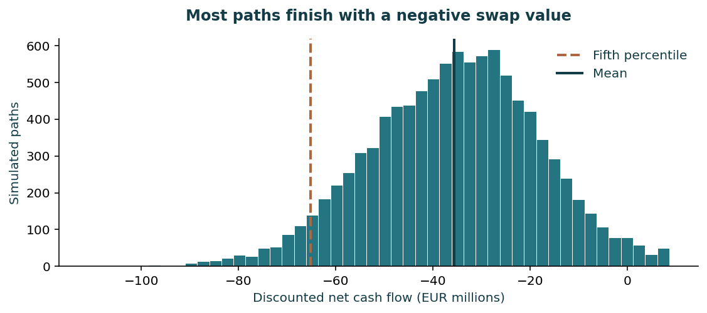

# AlpineSwap

A municipal borrower receives a fixed 5.10 percent coupon and pays a rate linked to EUR/CHF on an amortising loan. I examined how a stronger Swiss franc changes the borrower's payments over fifteen years, and why a few early savings can coexist with a large loss over the life of the swap.

## Follow one payment

Open the [Excel workbook](AlpineSwap.xlsx). The **Inputs** sheet contains the market assumptions. **Scenario** follows each annual fixing through the coupon, outstanding principal and discounted net cash flow. Change the fixed shock on one row to see how the rest of the path changes. The public edition follows the original workbook's introductory coupons of 2.00 percent for two years and 3.50 percent for two more. From year five, a fixing below 1.47 triggers the extra coupon.

The 2014 row in the original workbook checked the 2014 barrier but used the 2013 fixing inside the payoff. I corrected both parts to use the same year's fixing. Each Python step also uses the elapsed time between payment dates. This keeps the Brownian increment independent of how many scenarios are simulated.

## What the model produced

With 10,000 simulated paths and seed 2025, the mean discounted net cash flow was **EUR -35.67 million**. The fifth percentile was **EUR -65.14 million**, and **98.23 percent** of simulated paths ended below zero. These are outcomes under the case's specified rates and volatility. The zero-shock path gives EUR -34.62 million in Excel and Python.



## Check a fixing against the workbook

| Discounted value to the borrower | EUR |
| --- | ---: |
| Fifteen annual shocks set to zero | -34,621,290.55 |
| Change only the 2014 shock to -2 standard deviations | -45,759,578.17 |
| Difference | -11,138,287.62 |

Each row uses the principal outstanding at the beginning of its period. Interest uses the actual number of days divided by 360. The currency path advances on a 365-day basis. When the post-introductory fixing is below the barrier, the extra coupon depends on strike divided by that year's fixing. The model then discounts the net receipt in euros. A negative value is a cost to the borrower.

To compare Excel and Python, set the **2014** shock in the Scenario sheet to -2 and leave every other shock at zero. This is a deterministic comparison at the contract level. The distribution above is a separate Monte Carlo run under the workbook's fixed rates and volatility.

```sh
python swap.py --paths 10000 --seed 2025 --stress-year 2014 --stress-sigma -2
```

## Reproduce the study

```sh
python -m pip install -r requirements.txt
python swap.py --paths 10000 --seed 2025
```

The [Python model](swap.py) reads the same inputs as Excel. To run a batch inside desktop Excel, save a copy of the workbook as an Excel macro-enabled workbook, import [ScenarioAnalysis.bas](vba/ScenarioAnalysis.bas) and run `RunScenarios`. Each row of **Runs** records the full swap and its 2014 and 2020 payments on the same path. The fixed shocks in **Scenario** can be used without macros.

Tom Bussard
